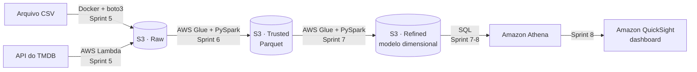

---
## 🧭 Comece por aqui

Este repositório mostra, sprint a sprint, um **ciclo completo de dados na nuvem AWS**: da ingestão de arquivos e de uma API até um dashboard no Amazon QuickSight, passando por um data lake em camadas no S3 (Raw → Trusted → Refined).

### Roteiro de estudo

| Sprint | Tema | O que você aprende |
|---|---|---|
| [1](Sprint%201) | SQL e modelagem | Modelo relacional e dimensional (fato e dimensões) em SQLite |
| [2](Sprint%202) | Python para dados | Análise com Pandas e um ETL simples em Python puro |
| [3](Sprint%203) | Docker | Rodar ETL e análise em contêineres que compartilham volumes |
| [4](Sprint%204) | Primeiros passos na AWS | Amazon S3, labs de Athena e Lambda, acesso via boto3 |
| [5](Sprint%205) | Ingestão (camada Raw) | Upload de CSV para o S3 com Docker e coleta da API do TMDB com Lambda |
| [6](Sprint%206) | Processamento (camada Trusted) | Jobs no AWS Glue com PySpark gravando em Parquet |
| [7](Sprint%207) | Modelagem (camada Refined) | Glue gerando tabelas fato e dimensão para análise |
| [8](Sprint%208) | Visualização | Consultas no Athena e dashboard com storytelling no QuickSight |

Cada sprint tem a mesma estrutura: `Desafio/` (projeto principal com README passo a passo), `Exercicios/`, `Evidencias/` (prints da execução) e `Certificados/`.

### ⚠️ Antes de reproduzir na sua conta AWS

- **Custos:** S3 e Lambda costumam caber no nível gratuito, mas **AWS Glue, Athena e QuickSight cobram por uso** (o QuickSight tem apenas um período de teste). Crie um alerta no **AWS Budgets** e, ao terminar, apague os jobs do Glue, os buckets e a assinatura do QuickSight.
- **Credenciais:** nunca coloque chaves de acesso no código. Os projetos leem tudo de variáveis de ambiente ou de um arquivo `.env`, que está no `.gitignore` (veja as Sprints 4 e 5).

### Licença

Código liberado sob a [licença MIT](LICENSE): pode estudar, copiar e adaptar, mantendo o aviso de autoria.

---
## Sobre mim

- 🎯 Atuo como **Engenheiro de prompt** na **Outlier AI**, desenvolvendo e aprimorando prompts para inteligência artificial generativa (chat gpt).
- 💻 Curso **Bacharelado em Sistemas de Informação** no **Centro Universitário 7 de Setembro (UNI7)**.
- 🏛  Atuei na **Universidade Federal do Ceará (UFC)**, por meio da **FUNDAÇÃO CETREDE** (jan 2024 - jan 2025), desenvolvendo soluções para análise e organização de **dados governamentais**. 
- 🚀 Utilizo algoritmos desenvolvidos em **Python**, com destaque para bibliotecas como **PyXLSB, Pandas**.
- 📊 Minhas soluções impactam diretamente na **geração de relatórios estratégicos** e na **automação de processos**, otimizando a análise de grandes volumes de dados.

---
### 🌟 Destaques Acadêmicos

- ⭐ Um dos meus maiores destaques foi liderar o projeto **Tech T.T.I**, conectando a **UNI7** e a **UFC** para organizar um treinamento prático sobre:  
- 🤖 **Inteligência Artificial**  
- 🔄 **Transformação Digital**  
- 📚 O evento beneficiou mais de 25 alunos, promovendo aprendizado prático em tecnologias que moldam o futuro.  

---
### 🎸 Interesses Pessoais

- 🎵 Gosto de tocar guitarra e praticar atividades físicas na academia.  
- 📖 Também exploro livros e temas ligados à **cultura brasileira**. Esses interesses ajudam a expandir minha visão criativa e compreender diferentes contextos culturais.  
